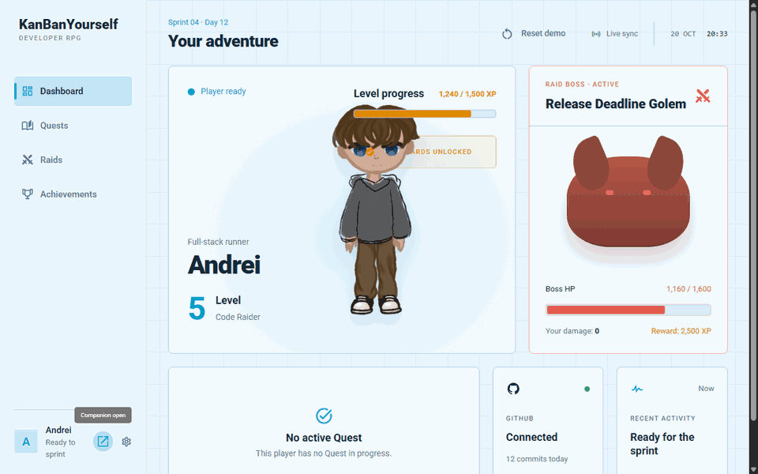
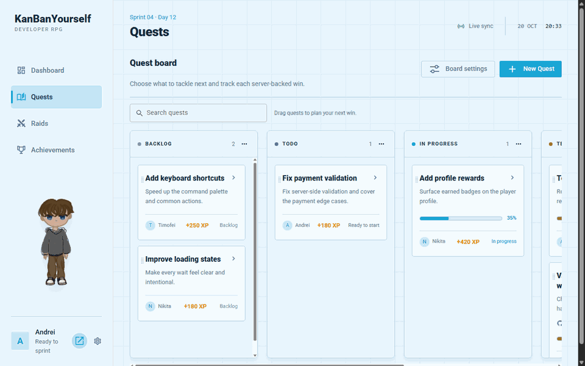
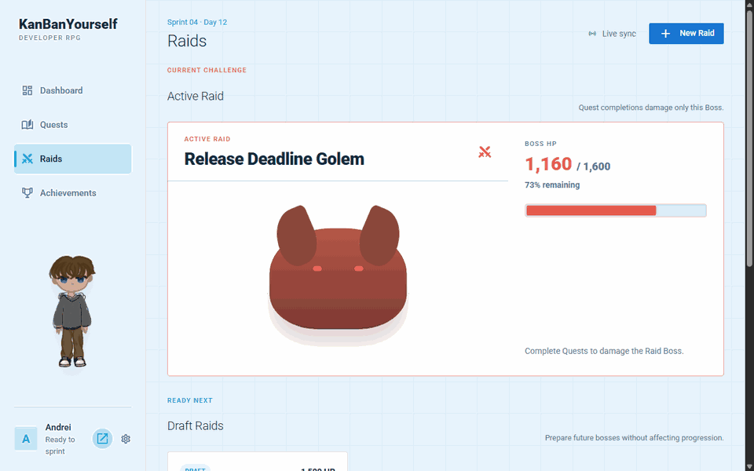
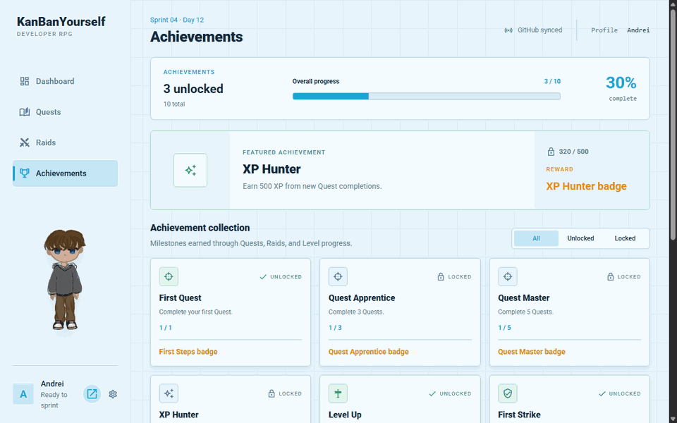

# VibeSprint

**Turn everyday development work into a shared RPG adventure.** VibeSprint is a gamified project dashboard for small development teams. Work is tracked as Quests; finishing a Quest awards XP, develops your character, and damages the team's active Raid boss. Achievements mark milestones along the way.



The app combines a Vue/Quasar interface with a Spring Boot API. Quests, player progress, and Raids are stored in PostgreSQL; updates reach the UI through WebSocket events. GitHub issue integration is available when configured, while the built-in demo can be explored without a GitHub account.

## See it in action

### 1. Explore the dashboard

The dashboard brings the selected player's level and XP, the active Raid boss, and recent activity together. The profile menu lets you switch between demo teammates. When a Quest is completed, the backend applies the reward and the UI reflects the resulting player and Raid progress.

### 2. Plan work as Quests



The board organizes Quests across **Backlog, Todo, In Progress, Testing, and Done**. The demo opens the new Quest form and an existing Quest's details, where you can see its assignee, progress, and XP reward. Quests can also be searched, edited, moved, and completed.

### 3. Prepare a team Raid



The Raids screen shows the active boss's remaining HP and opens the form for a new draft Raid. Quest completions deal damage to the active boss, turning individual work into a shared goal.

### 4. Track Achievements



Achievements show unlocked milestones and progress toward locked ones. The demo switches to the **Locked** filter so you can see what a player is working toward.

> These GIFs show the seeded demo state. Their forms and panels are examples of the interface; no Quest or Raid is created by the recordings. GitHub status labels in this state are illustrative; live sync requires valid credentials.

## Run locally

You need **Java 21**, **Node.js 22.12+**, and **Docker** with Docker Compose.

1. Start PostgreSQL from the repository root:

   ```bash
   docker compose up -d
   ```

2. Start the API from `backend`:

   ```bash
   ./mvnw spring-boot:run
   ```

   On Windows, use `.\mvnw.cmd spring-boot:run`. The API runs at [localhost:8080](http://localhost:8080/api/health).

3. In another terminal, start the interface from `frontend`:

   ```bash
   npm ci
   npm run dev
   ```

   Open [localhost:9000](http://localhost:9000). The frontend proxies `/api` to the backend and connects to its WebSocket endpoint. Use **Reset demo** on the dashboard to restore the seeded scenario.

For local use without GitHub sync, set `GITHUB_SYNC_ENABLED=false` in the backend process environment. To enable the integration, provide a valid `GITHUB_TOKEN` and configure `GITHUB_REPOSITORY`. The demo itself does not require GitHub connectivity.

## How it works

The Vue 3 + TypeScript frontend uses Quasar for the UI and Pinia for shared state. Spring Boot owns Quest, XP, achievement, and Raid rules, persists them in PostgreSQL with Liquibase migrations, and publishes changes over WebSocket/STOMP. Docker Compose runs the local database. GitHub integration is optional; game progress remains a backend decision whether a completion comes from the demo or an external event.

## Checks

From `frontend`, run `npm run typecheck` and `npm run build`. From `backend`, run `./mvnw test` (or `.\mvnw.cmd test` on Windows).
